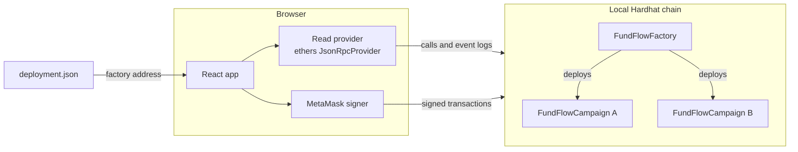
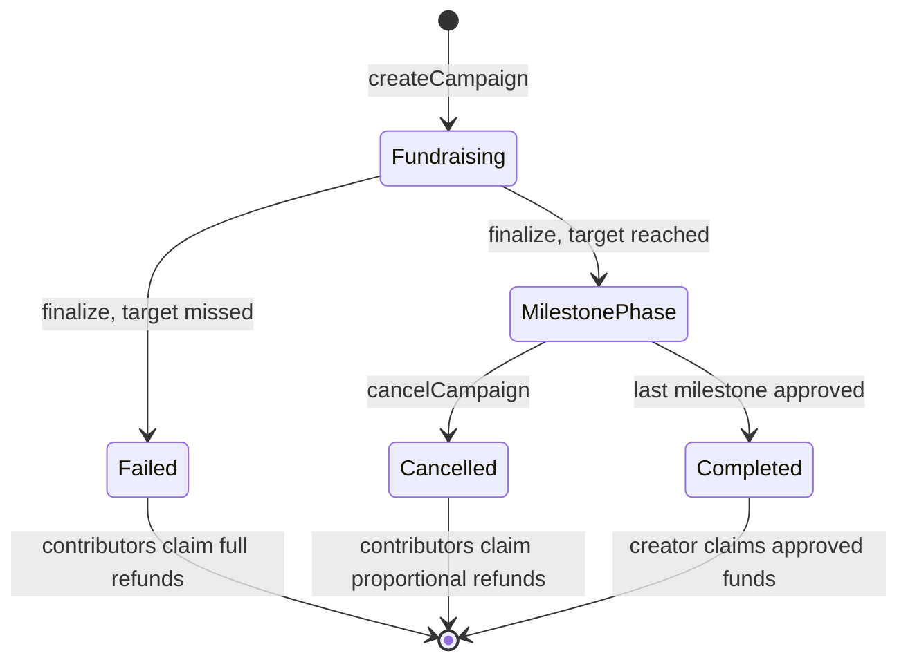

# FundFlow

**A Decentralized Crowdfunding Platform with Milestone-Based Fund Release and Community Governance**

A university Blockchain Technology project. FundFlow runs on a local Hardhat development chain with test ETH only. It has not had a professional security audit and is not production-ready.

## Contents

1. [Project overview](#1-project-overview)
2. [Problem statement](#2-problem-statement)
3. [Proposed solution](#3-proposed-solution)
4. [Main innovation](#4-main-innovation)
5. [Features](#5-features)
6. [Technology stack](#6-technology-stack)
7. [System architecture](#7-system-architecture)
8. [Smart contract architecture](#8-smart-contract-architecture)
9. [Campaign lifecycle](#9-campaign-lifecycle)
10. [Milestone voting logic](#10-milestone-voting-logic)
11. [Fund-release mechanism](#11-fund-release-mechanism)
12. [Refund mechanism](#12-refund-mechanism)
13. [Contract security considerations](#13-contract-security-considerations)
14. [Installation](#14-installation)
15. [Windows PowerShell commands](#15-windows-powershell-commands)
16. [Running contract tests](#16-running-contract-tests)
17. [Starting the local blockchain](#17-starting-the-local-blockchain)
18. [Deploying the contracts](#18-deploying-the-contracts)
19. [Configuring MetaMask](#19-configuring-metamask)
20. [Starting the frontend](#20-starting-the-frontend)
21. [Creating a campaign](#21-creating-a-campaign)
22. [Contributing and voting](#22-contributing-and-voting)
23. [Testing refunds](#23-testing-refunds)
24. [Troubleshooting](#24-troubleshooting)
25. [Known limitations](#25-known-limitations)
26. [Future improvements](#26-future-improvements)

## 1. Project overview

FundFlow lets entrepreneurs, student innovators and early-stage founders raise funds for a project. Funds are held by a smart contract and released in predefined stages, each one decided by the people who contributed. The contract, not the website, enforces every financial and voting rule.

## 2. Problem statement

On traditional crowdfunding platforms a creator usually receives the money in one payment once the campaign succeeds. Contributors have little visibility into how the project progresses and no say over later spending.

## 3. Proposed solution

Every campaign is its own smart contract with a fixed plan: a funding target, a deadline, and a list of milestones with fixed percentage allocations. Money stays in the contract until contributors approve each milestone. If a campaign misses its target, or a milestone is not approved, contributors can claim their money back, excluding funds already approved for release.

## 4. Main innovation

FundFlow combines three mechanisms that work together on-chain:

1. **Blockchain crowdfunding:** contributions and totals are public and held by a contract with no admin.
2. **Milestone-based release:** a creator receives funds in stages, not as a lump sum.
3. **Contributor governance:** contribution-weighted votes decide whether each stage is released.

## 5. Features

- Campaign creation through a five-step wizard, validated in the browser and again in Solidity
- Contributions in test ETH, with a permissionless finalize step after the deadline
- Evidence submission, weighted voting, and permissionless vote resolution
- A claim-based release that separates approval, claimability and transfer
- Full refunds for failed campaigns and proportional refunds for cancelled ones
- Creator and contributor dashboards, a governance page, transaction history from real contract events, and creator profiles with on-chain statistics
- MetaMask integration covering account and network changes
- Responsive layouts plus loading, empty, pending, success and error states
- An optional seed script that creates clearly labelled local demo campaigns through the real contracts

There is no AI or machine learning, no payment gateway, no real cryptocurrency, and no backend server.

## 6. Technology stack

| Layer | Tools |
|---|---|
| Contracts | Solidity 0.8.28, OpenZeppelin Contracts 5 (`ReentrancyGuard`) |
| Development chain and tests | Hardhat 2, Hardhat Toolbox (Mocha, Chai, network helpers, coverage) |
| Frontend | React 19, Vite, TypeScript, Tailwind CSS 4, React Router |
| Web3 | Ethers.js v6, MetaMask |
| UI | Lucide icons, Recharts |

Hardhat 2 is used because Hardhat Toolbox 6, its matcher library and its time helpers form one consistent, well-documented set.

## 7. System architecture



| Runs on-chain | Runs in the browser |
|---|---|
| Holding funds, tracking contributions | Displaying contract state |
| Deadlines, finalization, campaign state | Input validation for faster feedback (repeated on-chain) |
| Vote recording, counting, the 60% threshold | Deciding which buttons to show |
| Release amounts, refunds, cancellation rules | Asking MetaMask to sign transactions |

The UI hides actions that would fail, but it is not a safeguard. A transaction that breaks a rule reverts no matter how it was sent.

The frontend reads through its own RPC connection, so visitors can browse without a wallet. It polls for new blocks, re-reads contract state on each one, and builds history from event logs. Displayed countdowns use chain time, not the browser clock, so they stay correct after the local clock is advanced.

### Project layout

```
contracts/          FundFlowFactory.sol, FundFlowCampaign.sol, test/MockActor.sol (test-only)
scripts/            deploy.ts, seed-demo.ts, advance-time.js
test/               Contract test suites and helpers
deployments/        Generated deployment info (localhost.json)
frontend/public/    Generated deployment.json consumed by the app
frontend/src/
  abi/              Contract ABIs, refreshed by the deploy script
  components/       Reusable UI, including VotingPanel, MilestoneTimeline, TransactionHistory
  context/          Chain, data, wallet and transaction state
  hooks/            usePositions
  pages/            One file per route
  services/         Contract reads, writes, events and configuration
  types/, utils/    Shared types, formatting, error text, status helpers
```

## 8. Smart contract architecture

**`FundFlowFactory`** deploys one campaign per call and indexes them, globally and per creator. It holds no funds and has no admin, so it cannot change or stop a campaign. It also exposes the protocol limits for the frontend to validate against.

**`FundFlowCampaign`** holds one campaign's funds and enforces its whole lifecycle.

**Why one contract per campaign:** each campaign's money is isolated, its balance is easy to inspect, and each contract is small enough to explain.

### Fixed rules

| Rule | Value |
|---|---|
| Milestones per campaign | 1 to 10 |
| Allocations | Positive basis points that total exactly 10,000 (100%) |
| Fundraising duration | Deadline in the future, at most 365 days away |
| Voting period | 5 minutes to 30 days, set at creation, then fixed |
| Approval threshold | 60% of participating weight |
| Evidence submission window | 90 days per milestone |

Text fields have length limits. Invalid input reverts with a named custom error.

### Events

`CampaignCreated`, `ContributionReceived`, `CampaignFinalized`, `MilestoneEvidenceSubmitted`, `VoteCast`, `MilestoneApproved`, `MilestoneRejected`, `MilestoneExpired`, `MilestoneFundsClaimed`, `CampaignCompleted`, `CampaignCancelled`, `RefundClaimed`.

## 9. Campaign lifecycle



- **Contributions** are accepted while `block.timestamp < deadline`. Amounts above the target are accepted until then.
- **Finalization** is allowed when `block.timestamp >= deadline`. Anyone can call it, and it never happens early, even if the target is met. At any given second exactly one of contributing and finalizing is possible.
- **Success** means `totalRaised >= fundingTarget`.

## 10. Milestone voting logic

1. The creator submits an evidence reference for the current milestone. Milestones run in order, each submitted once, with no resubmission. This opens the vote.
2. Contributors vote approve or reject during the voting period, strictly before the deadline.
3. Weight equals the wallet's recorded contribution. Contributions cannot change after fundraising, so weights are frozen.
4. One vote per wallet per milestone, final once cast.
5. **The creator cannot vote**, even if they contributed. This avoids a conflict of interest. Their contribution is left out of the eligible weight.
6. Anyone may call `resolveMilestone()` once the voting deadline has passed, or earlier if all eligible weight has voted, because the result can no longer change.

### The result

```
participating = approveWeight + rejectWeight

participating == 0                                       -> Expired
approveWeight * 10000 >= participating * 6000            -> Approved
otherwise                                                -> Rejected
```

The comparison is cross-multiplied, so there is no division and no rounding. The threshold is measured against weight that participated, not total weight.

| Outcome | Funds | Next step |
|---|---|---|
| Approved | Allocation becomes claimable | Next milestone begins, or the campaign completes |
| Rejected | None released | Anyone may cancel |
| Expired (no votes) | None released, never counted as approval | Anyone may cancel |

Evidence is a reference (URL, content ID or short text). **The platform records it but does not verify it**, and the content behind a URL can change. Judging it is up to contributors.

## 11. Fund-release mechanism

These are three separate states, shown separately in the UI:

1. **Approved:** the vote passed.
2. **Claimable:** the allocation is counted in `totalApproved`.
3. **Transferred:** the creator called `claimMilestoneFunds`, and the ETH moved.

**Amount:** `totalRaised * allocationBps / 10000`, rounded down. The last milestone takes the remainder, so milestone amounts always total exactly `totalRaised` and no release dust is left in the contract.

Only the creator can claim, each milestone only once, and only for approved milestones. If the ETH transfer fails, the whole transaction reverts and the claim stays available.

## 12. Refund mechanism

### Failed campaigns

Each contributor claims exactly what they contributed, individually, once. The creator cannot withdraw anything.

### Cancellation policy

`cancelCampaign()` is allowed only in the milestone phase:

| Situation | Who may cancel |
|---|---|
| Current milestone rejected | Anyone |
| Current milestone's vote expired with no votes | Anyone |
| Creator made no submission within 90 days of the milestone starting | Anyone |
| Current milestone pending, creator gives up | Creator only |
| A vote is open or unresolved | Nobody, so a vote cannot be escaped |

The 90-day window exists so that a creator who disappears cannot lock funds forever. Its clock restarts after each approval. Once it passes, evidence can no longer be submitted.

### Proportional refund formula

```
refundPool = totalRaised - totalApproved
refund     = contribution * refundPool / totalRaised    (rounded down)
```

- **Approved allocations are not refundable, even if unclaimed.** The creator can still claim them after cancellation, and contributors cannot drain that share by claiming first.
- **Money already released is not refundable.** If 30% was released, contributors share the other 70%.
- **Rounding dust:** the last contributor to claim receives the remainder of the pool instead of their rounded-down share, at most (contributors - 1) wei extra. Refunds therefore total exactly the pool and can never exceed it.
- **A creator who contributed** is treated like any contributor for refunds, and receives only the share of their own contribution.
- **Failed campaigns** use the same formula with `refundPool = totalRaised`, which gives each contributor exactly their contribution.

## 13. Contract security considerations

- **Checks-effects-interactions** ordering, plus OpenZeppelin `ReentrancyGuard` on the two functions that send ETH. Tests attack both with a re-entering contract.
- **Failed transfers revert** the whole transaction, so state is never left half-updated. Tests cover a wallet that refuses ETH and later accepts it.
- **Internal accounting:** entitlements come from recorded totals, not `address(this).balance`, so ETH forced into the contract cannot change anyone's share. Payments also check that the balance is sufficient.
- **Access control** uses `msg.sender`. `tx.origin` is not used anywhere.
- **No admin keys, upgrades or pause.** No party can change a campaign's rules after deployment.
- **Bounded loops:** the only loops run over milestones, at most 10. Refunds are individual claims, so no loop runs over contributors.
- **Integer arithmetic only**, with Solidity 0.8 overflow checks. The frontend uses `bigint` and ethers utilities for all amounts.
- **Plain ETH transfers are rejected**, so funds can only enter through `contribute()`.
- One low-level `call` remains for sending ETH. This is intentional, because `transfer` forwards a fixed gas stipend that smart-contract wallets may exceed.
- The contracts compile without warnings.

**This project has not had a professional security audit.** See [Known limitations](#25-known-limitations).

## 14. Installation

Requirements:

- Node.js 22 or newer (developed on Node 24)
- A browser with the MetaMask extension
- Windows with PowerShell, VS Code recommended. The commands also work on macOS and Linux.

From the project folder:

```powershell
npm run setup
```

This installs dependencies for both the root project and `frontend/`. No `.env` file is needed for the standard demo. `.env.example` lists the optional settings.

## 15. Windows PowerShell commands

Use two terminals and keep both open.

**Terminal 1, the blockchain:**

```powershell
npm run chain
```

**Terminal 2, deploy and start the app:**

```powershell
npm run deploy
npm run seed       # optional: labelled demo campaigns
npm run frontend
```

Then open http://localhost:5173.

| Command | Purpose |
|---|---|
| `npm run compile` | Compile the contracts |
| `npm test` | Run the contract tests |
| `npm run coverage` | Measure test coverage |
| `npm run chain` | Start the local node on port 8545 |
| `npm run accounts` | List the funded test accounts and their keys for MetaMask |
| `npm run deploy` | Deploy the factory and write the deployment config |
| `npm run seed` | Create labelled demo campaigns (moves chain time forward) |
| `npm run advance-time -- --minutes 10` | Move the chain clock forward by minutes |
| `npm run advance-time -- --days 3` | Move the chain clock forward by days |
| `npm run frontend` | Start the dev server |
| `npm run frontend:build` | Typecheck and produce a production build |

## 16. Running contract tests

```powershell
npm test
```

The tests run on Hardhat's in-process network, so no node needs to be running. They cover campaign creation, contributions, finalization, milestones, governance, fund release, refunds, cancellation, boundary timestamps, rounding dust, reentrancy and failed transfers.

## 17. Starting the local blockchain

```powershell
npm run chain
```

This prints 20 test accounts, each with 10,000 test ETH, along with their private keys. Those keys are public knowledge. **Never send real funds to them.**

## 18. Deploying the contracts

With the chain running:

```powershell
npm run deploy
```

The script refuses any chain other than 31337. It writes `deployments/localhost.json` and `frontend/public/deployment.json` (network, chain ID, factory address, deployment block and ABI references), and refreshes the ABIs in `frontend/src/abi/`. The frontend reads the address from that file, so nothing is hardcoded in components.

**Reset:** stop the chain with Ctrl+C, then run `npm run chain` and `npm run deploy` again. The local chain keeps nothing between restarts, so **all campaigns disappear**. The app detects this and shows a banner until you redeploy.

## 19. Configuring MetaMask

The in-app **Wallet setup** page (`/setup`) has these same steps, plus a button to add the network.

1. Add a network with these values:
   - Network name: `Hardhat Local`
   - RPC URL: `http://127.0.0.1:8545`
   - Chain ID: `31337`
   - Currency symbol: `ETH`
2. Import test accounts: run `npm run accounts` to list them, copy a private key, then in MetaMask choose **Add account > Private key** and paste it. A new MetaMask account of your own shows 0 ETH, because only these test accounts are funded. Import at least two, one creator and one contributor. For a full demo, import three.

**Safety:** only paste these keys into MetaMask, never into a website. These accounts are for this local chain only. Consider using a separate browser profile. FundFlow never asks for a seed phrase or private key, and no key is stored in the frontend or in environment files.

## 20. Starting the frontend

```powershell
npm run frontend
```

Open http://localhost:5173 and click **Connect wallet**. Browsing works without a wallet.

## 21. Creating a campaign

1. Choose **Start a campaign**.
2. Enter a title, a description and an optional image URL.
3. Set the target, fundraising period and voting period. For a quick demo use 10 minutes for fundraising and 5 minutes for voting.
4. Add milestones until the allocations total 100%.
5. Review the summary, then **Create campaign** and confirm in MetaMask. You land on the new campaign's page once the transaction is mined.

## 22. Contributing and voting

A complete run with three accounts (creator, contributor A, contributor B):

1. **Contribute:** switch MetaMask to contributor A, open the campaign, contribute. Repeat with contributor B so the target is met.
2. **End fundraising:** wait for the deadline, or skip ahead:
   ```powershell
   npm run advance-time -- --minutes 11
   ```
3. **Finalize:** any account can click **Finalize campaign**.
4. **Submit evidence:** as the creator, enter a URL or content ID and submit.
5. **Vote:** as each contributor, choose **Inspect evidence and vote**, then approve or reject.
6. **Resolve:** click **Resolve vote** once everyone has voted or voting has ended (`npm run advance-time -- --days 3` skips the wait).
7. **Claim:** as the creator, click **Claim** and check that your balance rises.

## 23. Testing refunds

**Failed campaign:**

1. Create a campaign and contribute less than the target.
2. `npm run advance-time -- --minutes 11`, then **Finalize campaign**.
3. As the contributor, click **Claim refund**. You receive your full contribution, and the button disappears afterwards.

**Cancelled campaign, with a partial release:**

1. Run a campaign through an approved first milestone and claim its funds.
2. Submit evidence for the second milestone and vote to reject, using more than 40% of participating weight.
3. Advance time past the voting deadline, then **Resolve vote**.
4. Click **Cancel campaign**. Any account can do this.
5. Each contributor claims a proportional share of what remains. The campaign page shows the pool and the amount claimed.

`npm run seed` also creates demo campaigns in each state, including a failed one with refunds ready to claim using Hardhat account #3.

## 24. Troubleshooting

| Symptom | Fix |
|---|---|
| `npm run chain` stops at "Help us improve Hardhat..." | A one-time Hardhat question. Answer it, or run `$env:HARDHAT_DISABLE_TELEMETRY_PROMPT = 'true'` first to skip it |
| Banner: cannot reach the local blockchain | Run `npm run chain` and keep that terminal open |
| Banner: no FundFlow contract found | The chain was restarted. Run `npm run deploy` |
| Campaigns vanished | Expected after a chain restart, since they lived on that chain. Redeploy, and optionally reseed |
| MetaMask shows a nonce error or a transaction hangs after a reset | MetaMask remembers the old chain. Open **Settings > Advanced > Clear activity tab data** |
| Wrong network warning | Click **Switch network**, or add the network from section 19 |
| Wallet balance is zero | Select the Hardhat Local network (chain ID 31337), then click **Get 100 test ETH** in the banner. Or import a funded account from `npm run accounts` |
| "Install MetaMask" stays visible | Enable the extension for this site and reload |
| Deadline shows as passed earlier than expected | The chain clock runs ahead after `advance-time` or `seed`. The app shows chain time |
| `npm run deploy` cannot connect | Start the chain first. Port 8545 must be free |
| `Assertion failed: !(handle->flags & UV_HANDLE_CLOSING)` when a Hardhat command exits on Windows | A Node.js shutdown crash in Hardhat's native module. If the command printed its success output, the work completed. Node 22 LTS avoids it |

## 25. Known limitations

- **Not audited and not production-ready.** Only ever use it with test ETH on a local chain.
- **Evidence is not verified.** The contract stores a reference, and the off-chain content can change or disappear.
- **Sybil and self-funding risk.** A creator can contribute from other wallets to influence a vote. The creator exclusion only covers the creator's own address, and a creator could also meet their own target this way.
- **No quorum.** By the chosen rule, a single small voter can approve a milestone if nobody else votes. A short voting period makes this easier, though contributors see that period before contributing.
- **A rejected milestone cannot be retried.** One rejection means cancellation. Nothing forces anyone to cancel, so funds wait until someone does.
- **Unclaimed funds stay in the contract** until their owner claims them. There is no sweep function.
- **Released funds are final.** Contributors cannot recover money the creator has already received.
- **Text is stored on-chain,** which would be expensive on a real network.
- **Reads scale with campaign count.** The frontend reads all campaigns on each new block, which suits a demo and not a large deployment. There is no indexer.
- **Reputation figures** count outcomes only, and a creator can start over with a new wallet.

## 26. Future improvements

- A quorum based on total eligible weight
- A resubmission round after a rejected milestone
- Content-addressed evidence, stored on IPFS
- An indexer such as The Graph in place of log scanning
- A testnet deployment
- Sybil resistance through verified identity
- An independent security audit
